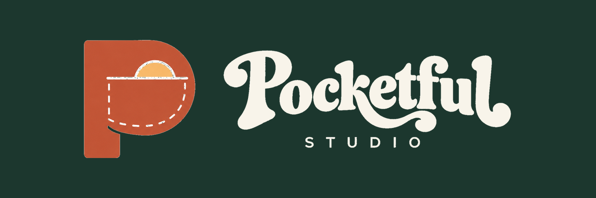
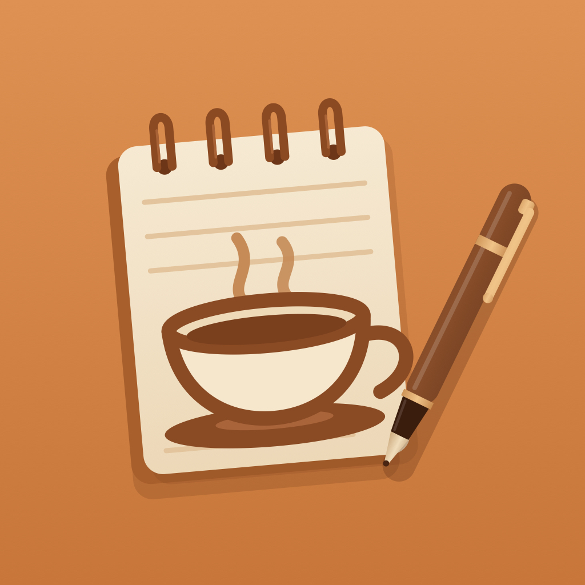

# Brew Log by Pocketful Studio

**Remember the recipe. Repeat the ritual.**

Your coffee journal, with a little help from Pocketful Studio. Keep your beans, recipes and tasting notes together, so your next cup can start with what worked.

Hello, we’re Pocketful Studio. We make small apps for everyday rituals. Brew Log is our place for the little details behind a good cup: the bag you opened, the grind you settled on and the flavours you’d like to find again. It’s currently in TestFlight, and your feedback helps us shape what comes next.

### Make yourself at home

[Visit the Brew Log website](https://pocketfulstudio-apps.github.io/brewlog-privacy/) · [FAQ & help](#frequently-asked-questions) · [Privacy policy](#privacy-policy) · [Email Pocketful Studio](mailto:pocketfulstudio.apps@gmail.com)

## Frequently asked questions

<strong>How do I log my first cup?</strong>

Add your coffee under Beans, then add your machine, grinder or basket under Gear. Go to Brews and tap Log a brew. Record the details you care about: dose, yield, grind, time and how it tasted. You can keep it simple and fill in more as you go.

<strong>Can I make a favourite brew again?</strong>

Yes. Open a saved brew and choose Brew again. Brew Log carries its settings into a new entry, so you only need to change what is different. You can adjust the recipe before saving.

<strong>Does it work for espresso and filter?</strong>

Yes. Espresso and milk drinks have their own fields. Filter brewing supports methods such as V60 and AeroPress, with water weight, bloom and total brew time. Choose your drink first so the form fits your cup.

<strong>When does the espresso timer start?</strong>

With pre-infusion enabled, start the timer when you start the pump, then mark when pressure builds. Brew Log records pre-infusion separately; the shot time starts at that second mark. For a machine without pre-infusion, use the no-pre-infusion option. Filter timing starts with the first pour and includes the bloom.

<strong>What is a batch, and why freeze dates?</strong>

A bean is the coffee; a batch is a particular bag of it. Buying the same coffee again can add a batch without creating a duplicate bean. Roast dates belong to batches. If you record a freeze date, Brew Log pauses its off-roast day count from that date; it is a journal aid, not a measurement of freshness.

<strong>How does “Will I like it?” work?</strong>

It compares the coffee details with preferences and rated brews saved on your device to estimate how well a coffee might suit you. More useful ratings give it more context. Taste is personal: treat the result as a starting point, not a promise.

<strong>Do I have to photograph every coffee?</strong>

No. You can enter a bean manually. A bag photo makes the library easier to recognise, and supported devices can read label text or remove the background. Check any suggested label details before saving them.

<strong>Why is background removal unavailable?</strong>

It depends on the device, operating system and installed build. On iPhone, the cutout feature needs supported Apple Vision capabilities; simulator support is limited. Keep the original photo or enter details manually if the feature is unavailable. Tell us your device and app build if something seems wrong.

<strong>Do I need an account or an internet connection?</strong>

No account is required. The core journal and on-device recommendations work offline. Opening support links, sending feedback, downloading app updates and some platform services need a connection.

<strong>Are my coffees and photos uploaded?</strong>

The current app does not automatically send your journal or photos to Pocketful Studio. Label reading, photo cutouts and brewing recommendations are processed on your device. Sharing is your choice. Apple handles TestFlight diagnostics separately; see the privacy policy for the details.

<strong>Can I share a recipe without my whole journal?</strong>

Yes. Use the sharing options on a brew. A recipe shares selected coffee, gear and recipe details; a brew card shares the content shown on the card. Review what you send, especially if you included personal details in a coffee or gear name. The receiving app or person gets the copy you choose to share.

<strong>Will my journal sync to another phone?</strong>

Brew Log does not currently provide its own cloud sync, account recovery or automatic journal export. Your operating system may include local app data in a device backup, depending on your settings. Check that backup before changing phones. Recipe sharing is not a full journal backup.

<strong>How do I delete my data?</strong>

Delete individual records using the app’s controls. To remove all local app data on iPhone, choose Delete App, rather than Offload App. Photos saved in your photo library, shared copies and device backups are separate and must be managed there. We cannot recover a journal stored only on your device.

<strong>Is Brew Log available to everyone yet?</strong>

Brew Log is currently being tested through TestFlight. Features may change between builds. If you already have an invitation, open it in TestFlight. To ask about joining, email Pocketful Studio. There is no public App Store download link on this page yet.

<strong>Is Brew Log free? Are there subscriptions?</strong>

The current TestFlight beta is available to invited testers without a Brew Log subscription. We have not announced final App Store pricing. If that changes, we will explain the price and included features before asking you to buy.

<strong>How do I report a bug or suggest something?</strong>

Use Send Beta Feedback in TestFlight, or email us. Include the app version and build, your phone model, operating system, what you expected and what happened. A screenshot helps, but hide anything personal first. Please do not post private journal details in a public GitHub issue.

## Privacy policy

Effective 1 November 2026. Last updated 2 November 2026.

Brew Log is published by Pocketful Studio. This policy covers the current mobile app and this support page.

### Your journal stays with you

Brew Log is a personal coffee journal published by Pocketful Studio. No account is required. Beans, batches, equipment, brew parameters, ratings, tasting notes, preferences and photos are stored locally on your device. The current app does not operate a service that receives your journal automatically.

We do not sell your journal data, use advertising trackers, or include third-party app analytics or crash-reporting SDKs. Apple’s TestFlight services are separate and are described below.

### Personalised brewing recommendations

Brew Log uses the coffee preferences, brewing parameters, equipment details and ratings you enter to personalise brewing recommendations on your device. This processing does not require uploading your journal.

We plan to offer optional data sharing to further personalise recommendations. This feature is not enabled in the current app. Before any uploads begin, we will explain what is sent, who processes it, how long it is kept, and how to withdraw consent or request deletion, and ask you to opt in. You do not opt in by visiting this page or using today’s local journal.

### Photos and permissions

Camera access is used when you choose to photograph a coffee bag. Photo access lets you select images and, with your permission, save photos taken in Brew Log to your photo library. You can manage permissions in your device settings. Denying access may limit those photo features; you can still enter coffees manually.

Label text recognition and background removal run on your device. Brew Log does not upload these photos to a cloud AI service. On Android builds, Google Play services may download required ML Kit models and handle service-related information under Google’s policies.

### Sharing and platform services

Sharing a card, recipe link or recipe file is an action you choose. The selected recipient or app receives that content, and its own privacy practices apply. Recipe sharing can include coffee names, coffee details, gear names and brewing parameters. Review the content before sharing. Brew Log does not automatically publish your journal.

Your operating system, app store, Google Play services and any device or photo backup services you enable may process information under their own policies. Local app data and saved photos may be included in device or cloud backups according to your settings. Brew Log does not provide its own cloud sync or backup service.

### TestFlight and diagnostics

While Brew Log is in TestFlight, Apple automatically collects beta usage and crash information and shares it with us. This can include build, device and operating-system details, sessions and crashes. Email invitations can reveal your name and email; if you join only through a public link, Apple does not show us your name or email through that invitation.

Feedback you choose to submit can include comments, screenshots and additional diagnostics. We use these to run the beta, troubleshoot problems and improve Brew Log. Apple controls the retention of its TestFlight records; we do not retain separate copies longer than needed for those purposes. See [Apple’s TestFlight & Privacy notice](https://www.apple.com/legal/privacy/data/en/test-flight/). Contact us about information you have sent us; requests concerning Apple-held information may also need to go to Apple.

### When you get in touch

If you email [pocketfulstudio.apps@gmail.com](mailto:pocketfulstudio.apps@gmail.com), we receive your email address and whatever you send. We use it to reply, provide support and improve the app, and keep correspondence only as long as needed for those purposes. Please avoid sending private journal information you do not want us to receive. You can ask us to delete correspondence, subject to any information we are required to retain.

Email is handled through our email provider. GitHub issues are public: use email for private questions.

### Keeping and deleting your data

Your journal remains on your device until you delete entries or remove the app’s local data. Use the available in-app controls to delete records. To remove all local app data, use your operating system’s app-data deletion controls or uninstall the app. On iOS, choose Delete App rather than Offload App.

Photos saved to your photo library, shared copies and existing backups are separate. Manage them in those apps or services. We cannot access, export, restore or delete a journal stored only on your device.

### Children

Brew Log does not knowingly collect children’s personal information through the journal or require users to provide personal details to us. If you think a child has sent us personal information through support, contact us so we can address it.

### Changes to this policy

If Brew Log’s privacy practices change, we will update this page and its date. A possible future feature is not permission to collect data now. Any future optional journal uploads will require the explanation and opt-in described above.

### Contact Pocketful Studio

For support, privacy questions or requests about information you have sent us, email [pocketfulstudio.apps@gmail.com](mailto:pocketfulstudio.apps@gmail.com). Please say you are asking about Brew Log.

### About this website

This website and its repository are hosted by GitHub. They contain no analytics scripts, advertising scripts, embedded third-party video players or contact-form trackers added by Pocketful Studio. GitHub may process visitor information under [GitHub’s Privacy Statement](https://docs.github.com/en/site-policy/privacy-policies/github-privacy-statement). Visiting this site does not give us access to your Brew Log journal.

## Say hello

Need help, have a suggestion, or want to ask about the beta? Email [pocketfulstudio.apps@gmail.com](mailto:pocketfulstudio.apps@gmail.com). Include your app version, phone model and what happened. Please keep private journal entries and photos out of public issues.

Also from Pocketful Studio: [OneTake](https://pocketfulstudio-apps.github.io/onetake/).

© 2026 Pocketful Studio
