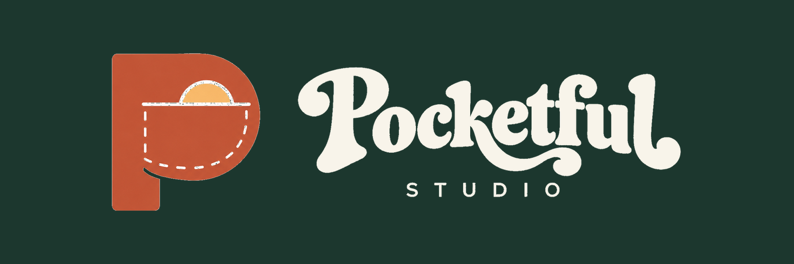
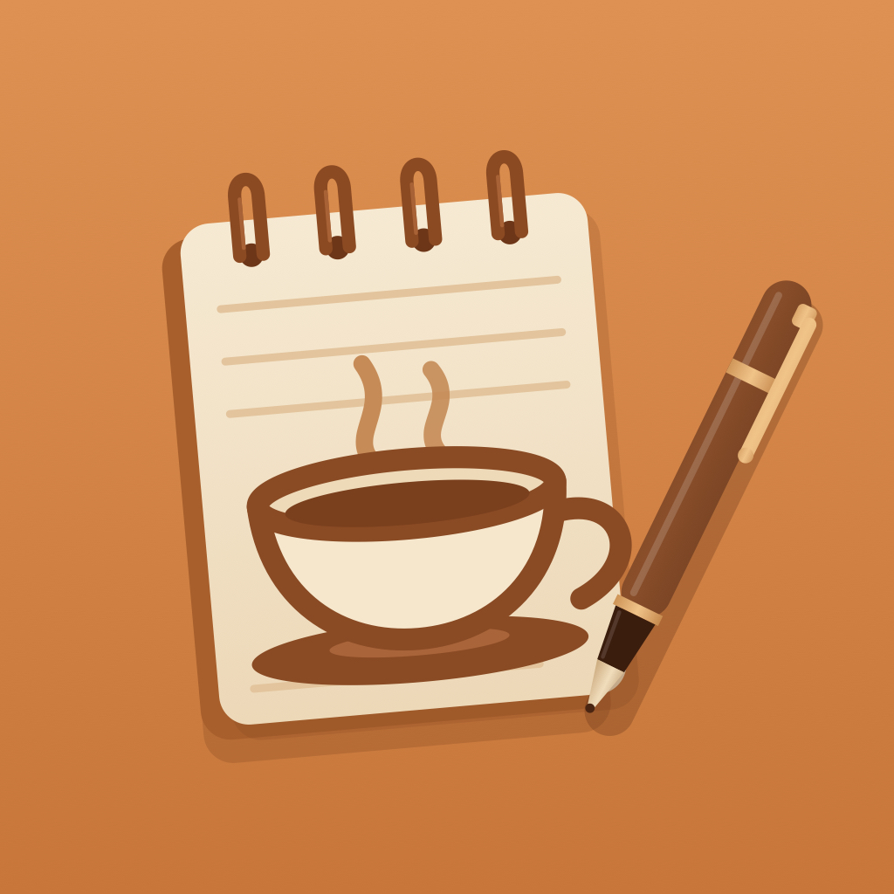

# Brew Log by Pocketful Studio

**Will I like this coffee?**

Check your next bag against the coffees you already love. Photograph a coffee bag, or enter its details. Brew Log uses your past ratings and taste preferences to show a personal match, explain the history behind it and suggest a way to brew it when a suitable past brew is available.

The percentage is a taste-match score, not a probability or a prediction accuracy claim. Your history and preferences shape the result.

[See the matching example on the Brew Log website](https://pocketfulstudio-apps.github.io/brewlog-privacy/).

Hello, we’re Pocketful Studio. We make small apps for everyday rituals. Brew Log helps turn the coffees you have enjoyed into useful context for the next bag you are considering. The journal keeps the ratings, recipes and tasting notes that make those recommendations personal. It’s currently in TestFlight, and your feedback helps us shape what comes next.

### Make yourself at home

[Visit the Brew Log website](https://pocketfulstudio-apps.github.io/brewlog-privacy/) · [FAQ & help](#frequently-asked-questions) · [Privacy policy](#privacy-policy) · [Email Pocketful Studio](mailto:pocketfulstudio.apps@gmail.com)

## Frequently asked questions

<strong>How does “Will I like this coffee?” work?</strong>

Photograph the bag or enter its origin, process, roast and tasting notes. Brew Log compares those details with coffees you have rated and your taste answers, then shows a personal match score and the history behind it. Where it has a suitable highly rated brew, it also suggests a drink or method and ratio. The score is a taste-match indicator, not the probability that you will enjoy the coffee or a measured prediction accuracy.

<strong>Can I check a coffee before I have rated any brews?</strong>

Yes. Start with the short taste questions. Early matches use those answers and are limited by the evidence available. As you add rated brews, your real history takes more weight. If there is not enough relevant information, Brew Log says so rather than promising a reliable match.

<strong>How do I log my first cup?</strong>

Add your coffee under Beans, then add your machine, grinder or basket under Gear. Go to Brews and tap Log a brew. Record the details you care about: dose, yield, grind, time and how it tasted. You can keep it simple and fill in more as you go.

<strong>Can I make a favourite brew again?</strong>

Yes. Open a saved brew and choose Brew again. Brew Log carries its settings into a new entry, so you only need to change what is different. You can adjust the recipe before saving.

<strong>Does it work for espresso and filter?</strong>

Yes. Choose how you extracted it first: Espresso, Ristretto, Lungo, Filter or Other, and the form fits your cup. Espresso and milk drinks have their own fields, with optional pressure in bar. Filter brewing covers the Hario V60, Kalita, Origami, AeroPress, French press and batch brew, with water weight, bloom and total brew time. Anything else, such as a moka pot, goes under Other, which shows every gear field.

<strong>When does the espresso timer start?</strong>

With pre-infusion enabled, start the timer when you start the pump, then mark when pressure builds. Brew Log records pre-infusion separately; the shot time starts at that second mark. For a machine without pre-infusion, use the no-pre-infusion option. Filter timing starts with the first pour and includes the bloom.

<strong>What is a batch, and why freeze dates?</strong>

A bean is the coffee; a batch is a particular bag of it. Buying the same coffee again can add a batch without creating a duplicate bean. Roast dates belong to batches. If you record a freeze date, Brew Log pauses its off-roast day count from that date; it is a journal aid, not a measurement of freshness.

<strong>What is the caffeine nudge?</strong>

An optional reminder each morning, set in Settings. It starts at 7:30 and then moves to when you usually brew, and it names a coffee worth a turn. A morning you have already logged gets none. Brew Log only asks for notification permission when you switch it on, and the reminders are scheduled on your phone; no server sends them.

<strong>Which languages does Brew Log speak?</strong>

English and Simplified Chinese. There is also a bilingual mode that shows Chinese with the English coffee terms beside it. Change it any time in Settings.

<strong>How do coffee photos work?</strong>

Each brew can have a photo of your cup. The camera opens with a square viewfinder, and a photo from your library opens in a square frame you can drag and pinch to choose the part you want. The full-size square is also saved to your photo library. Tap any coffee or bag photo to see it full screen and pinch to zoom.

<strong>Do I have to photograph every coffee?</strong>

No. You can enter a bean manually. A bag photo makes the library easier to recognise, and supported devices can read label text or remove the background. Check any suggested label details before saving them.

<strong>Why is background removal unavailable?</strong>

It depends on the device, operating system and installed build. On iPhone, the cutout feature needs supported Apple Vision capabilities; simulator support is limited. Keep the original photo or enter details manually if the feature is unavailable. Tell us your device and app build if something seems wrong.

<strong>Do I need an account or an internet connection?</strong>

No account is required. The core journal and on-device recommendations work offline. On iPhone, your journal backs itself up to your own iCloud whenever there is a connection. Opening support links, sending feedback, downloading app updates and some platform services need a connection.

<strong>Are my coffees and photos uploaded?</strong>

Never to Pocketful Studio. On iPhone, Brew Log backs your journal and its photos up to your own iCloud, which only you can open; we run no server that receives them. Label reading, photo cutouts and brewing recommendations are processed on your device. Sharing is your choice. Apple handles TestFlight diagnostics separately; see the privacy policy for the details.

<strong>Can I share a recipe without my whole journal?</strong>

Yes. Use the sharing options on a brew. A recipe shares selected coffee, gear and recipe details; a brew card shares the content shown on the card. Review what you send, especially if you included personal details in a coffee or gear name. The receiving app or person gets the copy you choose to share.

<strong>Is my journal backed up?</strong>

Yes, on iPhone. Each time you leave the app, Brew Log saves a copy of your journal and its photos to your own iCloud, as long as iCloud Drive is on. Settings › Backup shows when it last ran. On a new iPhone, or after reinstalling, sign in to the same Apple Account and Brew Log offers to bring the backup back. The backup counts toward your iCloud storage. iCloud keeps one Brew Log backup; it is not live sync between two devices. Android builds do not have automatic backup yet.

<strong>How do I delete my data?</strong>

Delete individual records using the app’s controls. To remove all local app data on iPhone, choose Delete App, rather than Offload App. To delete the iCloud backup as well, open Settings › your name › iCloud › Manage Storage, choose Brew Log and delete its data. Photos saved in your photo library and shared copies are separate and must be managed there. We cannot see, recover or delete your journal or its backup: they are yours.

<strong>Is Brew Log available to everyone yet?</strong>

Brew Log is currently being tested through TestFlight, and anyone with an iPhone can join through the public beta link: https://testflight.apple.com/join/jrJ8ywm3. Install Apple’s TestFlight app first, then open the link. Features may change between builds. The App Store release will follow the beta.

<strong>Is Brew Log free? Is there a subscription?</strong>

Brew Log is free to download, and the free version is a complete coffee journal: log brews, read bean labels, share brew cards and see the current week in the coffee calendar. Brew Log Pro is an optional monthly subscription. It adds unlimited active beans, unlimited “Will I like it?” checks (the free version includes 3 a day), smart suggestions, your full brew history and the whole coffee calendar with month and year cards. In Australia, Pro costs A$4.99 a month for the first 3 months, then A$9.99 a month. Other countries see their local price in the app before buying. Pro renews each month until you cancel, which you can do at any time in your Apple ID subscription settings. During the TestFlight beta, purchases use Apple’s test system and you are not charged.

<strong>How do I report a bug or suggest something?</strong>

Use Send Beta Feedback in TestFlight, or email us. Include the app version and build, your phone model, operating system, what you expected and what happened. A screenshot helps, but hide anything personal first. Please do not post private journal details in a public GitHub issue.

## Privacy policy

Effective 1 November 2026. Last updated 21 November 2026.

Brew Log is published by Pocketful Studio. This policy covers the current mobile app and this support page.

### Your journal stays with you

Brew Log is a personal coffee journal published by Pocketful Studio. No account is required. Beans, batches, equipment, brew parameters, ratings, tasting notes, preferences and photos are stored on your device. On iPhone they are also backed up to your own iCloud (see the next section). Pocketful Studio does not run a server that receives your journal, and we cannot open it.

We do not sell your journal data, use advertising trackers, or include third-party app analytics or crash-reporting SDKs. Apple’s TestFlight services are separate and are described below.

### Automatic backup to your iCloud

On iPhone, Brew Log backs up your journal and the photos it uses to the app’s private storage in your own iCloud account. This happens on your device when you leave the app, if iCloud Drive is turned on for Brew Log. Apple stores the backup under your Apple Account and the iCloud terms you have agreed to with Apple, and protects it with encryption in transit and at rest. If you turn on Advanced Data Protection, iCloud Drive is end-to-end encrypted and not even Apple can read it. If your Apple Account is in mainland China, iCloud is operated by Guizhou-Cloud Big Data (GCBD) under Apple’s terms.

Pocketful Studio never receives the backup and has no way to open it. Turning iCloud Drive off for Brew Log stops the backup. To protect your data, Brew Log copies a complete, consistent snapshot each time, a backup cut short never replaces the last good one, and an empty journal never replaces a backup. You can delete the backup in your iCloud storage settings.

### Personalised brewing recommendations

Brew Log uses the coffee preferences, brewing parameters, equipment details and ratings you enter to personalise brewing recommendations on your device. This processing does not require uploading your journal.

We plan to offer optional data sharing to further personalise recommendations. This feature is not enabled in the current app. Before any uploads begin, we will explain what is sent, who processes it, how long it is kept, and how to withdraw consent or request deletion, and ask you to opt in. You do not opt in by visiting this page or using today’s local journal.

### Photos and permissions

Camera access is used when you choose to photograph a coffee bag or your coffee. Brew Log does not record sound and does not ask for the microphone. Photo access lets you select images and, with your permission, save photos taken in Brew Log to your photo library. You can manage permissions in your device settings. Denying access may limit those photo features; you can still enter coffees manually.

Label text recognition and background removal run on your device. Brew Log does not upload these photos to a cloud AI service. On Android builds, Google Play services may download required ML Kit models and handle service-related information under Google’s policies.

### Caffeine nudge notifications

The caffeine nudge is off until you turn it on. When it is on, Brew Log asks your phone for notification permission and schedules the reminders on your device, choosing the time and wording from your own journal. No push server is involved and nothing about your brewing habits leaves your phone. Turn it off in Settings or in your phone’s notification settings.

### Brew Log Pro and purchases

Brew Log Pro is an optional subscription sold through Apple’s App Store. Apple handles the payment, your Apple Account and the subscription itself, under Apple’s terms and privacy policy. Brew Log asks the App Store on your device whether Pro is active; we do not receive your payment details, name or email. Apple gives developers sales and subscription reports that do not identify you to us. Manage or cancel Pro in your Apple Account’s subscription settings.

### Sharing and platform services

Sharing a card, recipe link or recipe file is an action you choose. The selected recipient or app receives that content, and its own privacy practices apply. Recipe sharing can include coffee names, coffee details, gear names and brewing parameters. Review the content before sharing. Brew Log does not automatically publish your journal. When you take a screenshot of a brew, Brew Log may offer its share card instead; it only notices that a screenshot happened and does not read or keep it. The Last brew widget on your Home Screen shows your latest brew and its photo; Brew Log hands it a copy on your device.

Your operating system, app store, Google Play services and any device or photo backup services you enable may process information under their own policies. Local app data and saved photos may also be included in your device’s own backups according to your settings. Apart from the iCloud backup described above, Brew Log has no sync or server of its own.

### TestFlight and diagnostics

While Brew Log is in TestFlight, Apple automatically collects beta usage and crash information and shares it with us. This can include build, device and operating-system details, sessions and crashes. Email invitations can reveal your name and email; if you join only through a public link, Apple does not show us your name or email through that invitation.

Feedback you choose to submit can include comments, screenshots and additional diagnostics. We use these to run the beta, troubleshoot problems and improve Brew Log. Apple controls the retention of its TestFlight records; we do not retain separate copies longer than needed for those purposes. See [Apple’s TestFlight & Privacy notice](https://www.apple.com/legal/privacy/data/en/test-flight/). Contact us about information you have sent us; requests concerning Apple-held information may also need to go to Apple.

### When you get in touch

If you email [pocketfulstudio.apps@gmail.com](mailto:pocketfulstudio.apps@gmail.com), we receive your email address and whatever you send. We use it to reply, provide support and improve the app, and keep correspondence only as long as needed for those purposes. Please avoid sending private journal information you do not want us to receive. You can ask us to delete correspondence, subject to any information we are required to retain.

Email is handled through our email provider. GitHub issues are public: use email for private questions.

### Keeping and deleting your data

Your journal remains on your device, and its backup in your iCloud, until you delete them. Use the available in-app controls to delete records. To remove all local app data, use your operating system’s app-data deletion controls or uninstall the app. On iOS, choose Delete App rather than Offload App.

Photos saved to your photo library, shared copies and existing backups are separate. Manage them in those apps or services. To delete the iCloud backup, open Settings › your name › iCloud › Manage Storage and delete Brew Log’s data. We cannot access, export, restore or delete your journal or its backup.

### Children

Brew Log does not knowingly collect children’s personal information through the journal or require users to provide personal details to us. If you think a child has sent us personal information through support, contact us so we can address it.

### Changes to this policy

If Brew Log’s privacy practices change, we will update this page and its date. A possible future feature is not permission to collect data now. Any future optional journal uploads will require the explanation and opt-in described above.

### Contact Pocketful Studio

For support, privacy questions or requests about information you have sent us, email [pocketfulstudio.apps@gmail.com](mailto:pocketfulstudio.apps@gmail.com). Please say you are asking about Brew Log.

### About this website

This website and its repository are hosted by GitHub. They contain no analytics scripts, advertising scripts, embedded third-party video players or contact-form trackers added by Pocketful Studio. GitHub may process visitor information under [GitHub’s Privacy Statement](https://docs.github.com/en/site-policy/privacy-policies/github-privacy-statement). Visiting this site does not give us access to your Brew Log journal.

## Say hello

Need help, have a suggestion, or want to ask about the beta? Email [pocketfulstudio.apps@gmail.com](mailto:pocketfulstudio.apps@gmail.com). Include your app version, phone model and what happened. Please keep private journal entries and photos out of public issues.

Also from Pocketful Studio: [OneTake](https://pocketfulstudio-apps.github.io/onetake/).

© 2026 Pocketful Studio
